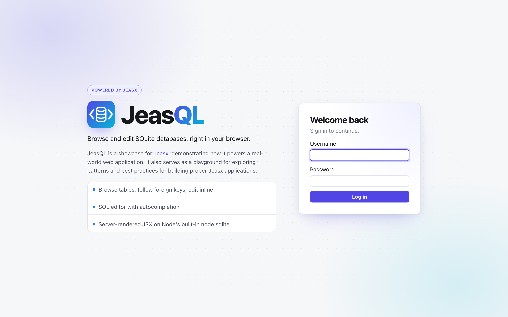
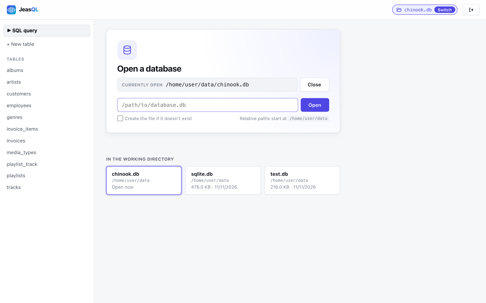
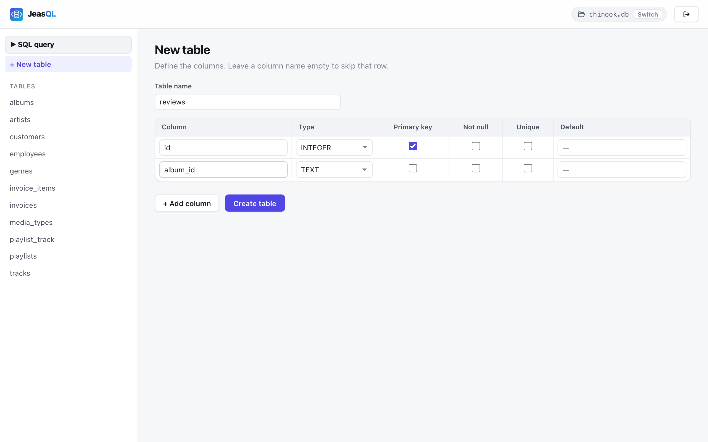
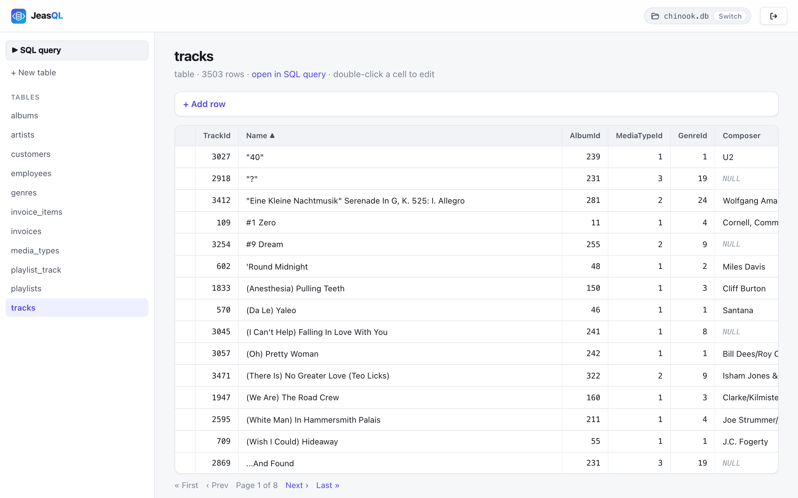
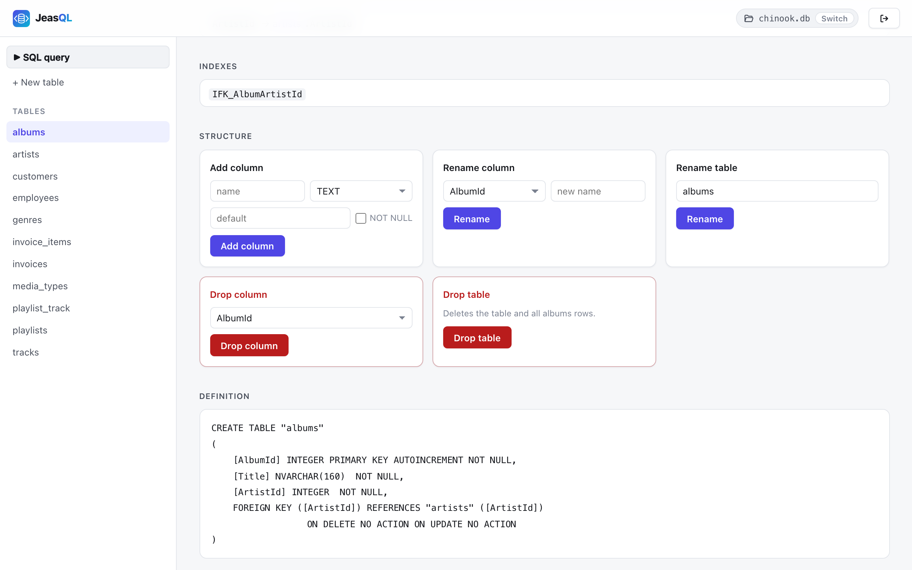
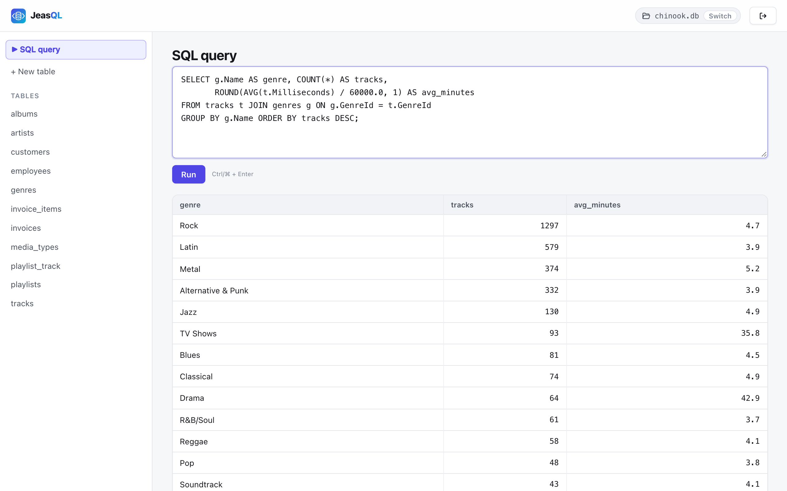

# JeasQL

A small web UI to browse and edit SQLite databases, built with [Jeasx](https://www.jeasx.dev) and Node's built-in `node:sqlite`.

JeasQL is a showcase for Jeasx, demonstrating how it powers a real-world web application. It also serves as a playground for exploring patterns and best practices for building proper Jeasx applications.

## Features

- Open any SQLite file by path, or create a new one; files in the working directory are listed for quick access
- Browse tables and views, follow foreign keys, download BLOBs
- Edit cells inline, insert and delete rows
- Create, rename and drop tables; add, rename and drop columns
- Run SQL queries in an editor with autocompletion
- Protected by a login with a fixed username and password

## Screenshots

**Log in:** with the username and password from the configuration



**Open a database:** by path, or pick a file from the working directory



**Create tables**



**Browse tables:** paged rows, sorting, inline editing



**Change the table structure:** add, rename and drop columns; rename or drop the table



**Run SQL queries**



## Requirements

Node.js 24 or newer, for `node:sqlite` and for running the TypeScript tests directly.

## Getting started

Development server at <http://localhost:3000>:

```sh
npm install
AUTH_USERNAME=admin AUTH_PASSWORD=secret npm run dev
```

Production:

```sh
npm run build
AUTH_USERNAME=admin AUTH_PASSWORD=secret npm start
```

### Sample database

Need some data to try it out? Use the [Northwind sample database](https://github.com/jpwhite3/northwind-SQLite3) (a trading company with orders, products, customers and employees). Download [`northwind.db`](https://github.com/jpwhite3/northwind-SQLite3/raw/main/dist/northwind.db) and open it in JeasQL.

## Configuration

Set these as environment variables, or put them in a `.env.local` file (ignored by git).

| Variable             | Default                                      | Description                                                                                                  |
| -------------------- | -------------------------------------------- | ------------------------------------------------------------------------------------------------------------ |
| `AUTH_USERNAME`      | –                                            | Username for the login. **Required.**                                                                        |
| `AUTH_PASSWORD`      | –                                            | Password for the login. **Required.**                                                                        |
| `AUTH_SECRET`        | random per start                             | Key that signs the session cookie. Changing it, or a restart without it, logs everyone out.                  |
| `AUTH_SESSION_HOURS` | `12`                                         | How long a login lasts. Logging out invalidates the session right away.                                      |
| `TRUST_PROXY`        | –                                            | Set to `true` behind a reverse proxy, so its `X-Forwarded-*` headers are trusted: the cross-site check uses `X-Forwarded-Host`, login rate limiting the real client IP. |
| `PORT`               | `3000`                                       | Port to listen on.                                                                                           |
| `HOST`               | `localhost` in dev, all interfaces otherwise | Interface to bind to.                                                                                        |

> Without `AUTH_USERNAME` and `AUTH_PASSWORD`, the app only shows a setup notice.
>
> After 10 failed logins within 15 minutes, a client (by IP) has to wait before it can try again. Behind a reverse proxy, set `TRUST_PROXY` so the real client IP is used.

> Logged-out sessions are remembered in memory only. With a fixed `AUTH_SECRET`, a copied cookie from a logged-out session becomes valid again after a server restart, until it expires (`AUTH_SESSION_HOURS`). To invalidate all sessions for sure, change `AUTH_SECRET` or `AUTH_PASSWORD`.

### Limits and security headers

- Request bodies are limited to 10 MB; BLOB uploads to 64 MB per file.
- Every response carries a strict Content Security Policy (own scripts, styles and images only), `X-Frame-Options: DENY`, `X-Content-Type-Options: nosniff` and related headers (see `jeasx.config.js`).

## Docker

```sh
docker build -t jeasql .
docker run -p 3000:3000 \
  -e AUTH_USERNAME=admin -e AUTH_PASSWORD=secret \
  -v "$PWD/data:/home/node/data" \
  jeasql
```

Then open `/home/node/data/your.db` in the app. The container reports its health via `/health`.

## Development

| Command         | Purpose                                |
| --------------- | -------------------------------------- |
| `npm run dev`   | Development server with rebuilds       |
| `npm test`      | Unit tests in `test/`                  |
| `npm run check` | Strict type check of the whole project |
| `npm run build` | Production build into `dist/`          |
| `npm run clean` | Remove the build output in `dist/`     |

The code is TypeScript: esbuild compiles it for the server and the browser, and Node runs the tests directly.

### Project layout

- `src/routes/`: one `[name].tsx` or `[name].ts` file per URL, e.g. `[show-table].tsx` → `/show-table`
  - `[...guard].ts`: runs before every route; checks login and CSRF, and redirects to the open page while no database is open
  - `[health].json`: health check at `/health`, used by the Dockerfile
- `src/components/`: JSX building blocks, e.g. `Layout` (with `Header` and `Sidebar`), `Hero` (centred card of the open, login and 404 pages), `Icon`, `DataTable`, `Cell`, `Pager`, and the sections of the table page (`Structure`, `ColumnList`, `Relations`, `AddRow`)
- `src/server/`: server-only code
  - `auth.ts` (login, sessions, signed messages), `csrf.ts` (cross-site request check), `flash.ts` (signed one-time notices after redirects)
  - `request.ts` (POST-only routes, error responses, form and upload parsing), `redirect.ts`, `forms.ts` (form fields → data), `errors.ts` (`attempt`, `errorMessage`)
  - `url.ts` (app links with query parameters), `links.ts` (links between pages), `rowKey.ts` (row keys sent to and from the browser), `paging.ts`
  - `files.ts` (SQLite files in the working directory), `guessType.ts` (BLOB download types)
  - `fields.ts` (reading and validating form, JSON and query fields), `classes.ts` (`cx` for CSS class names), `memo.ts` (`perRequest`: lookups cached for one request)
  - `db.ts`: database access, split into `db/connection.ts`, `db/schema.ts`, `db/rows.ts` and `db/sql.ts`. Code outside `db/` imports functions and types from `db.ts` only
- `src/browser/`: client-side code
  - `scripts/`, bundled by `index.ts`
  - `styles/`, bundled in order by `index.css`
- `src/types.d.ts`: shared types (`RouteProps`, `ThisContext`) and the request fields Jeasx adds
- `public/`: static files served as-is (`favicon.svg`, `robots.txt`)
- `test/`: unit tests

### Conventions

- **Routes:** routes that only handle an action are wrapped in `postOnly` (other methods get 405). Pages that both show a form and handle it (`create-table`, `open-database`, `login`) answer GET and check `isPost` themselves, so they can render the form again with an error.
- **Errors:** `errorResponse` answers with JSON `{"error": …}` when the client asked for JSON (scripts using fetch), otherwise with plain text. Pages show errors with `ErrorMessage`; after a redirect, they arrive as signed flash messages.
- **Names:** submitted form data is `fields` (read with `field`, `trimmed`, `requireText` and `checked` from `fields.ts`); `cols` are column definitions (`Column[]`), `columnNames` their names.

### File naming rules

- Keep every `[name].*` route file in `src/routes/`. esbuild drops the common `routes/` prefix from the output; a route file anywhere else in `src/` would move all URLs under `/routes/`.
- Don't name a file `index.*` outside `src/browser/`: Jeasx bundles every `src/**/index.*` for the browser.

## License

[MIT](LICENSE)
